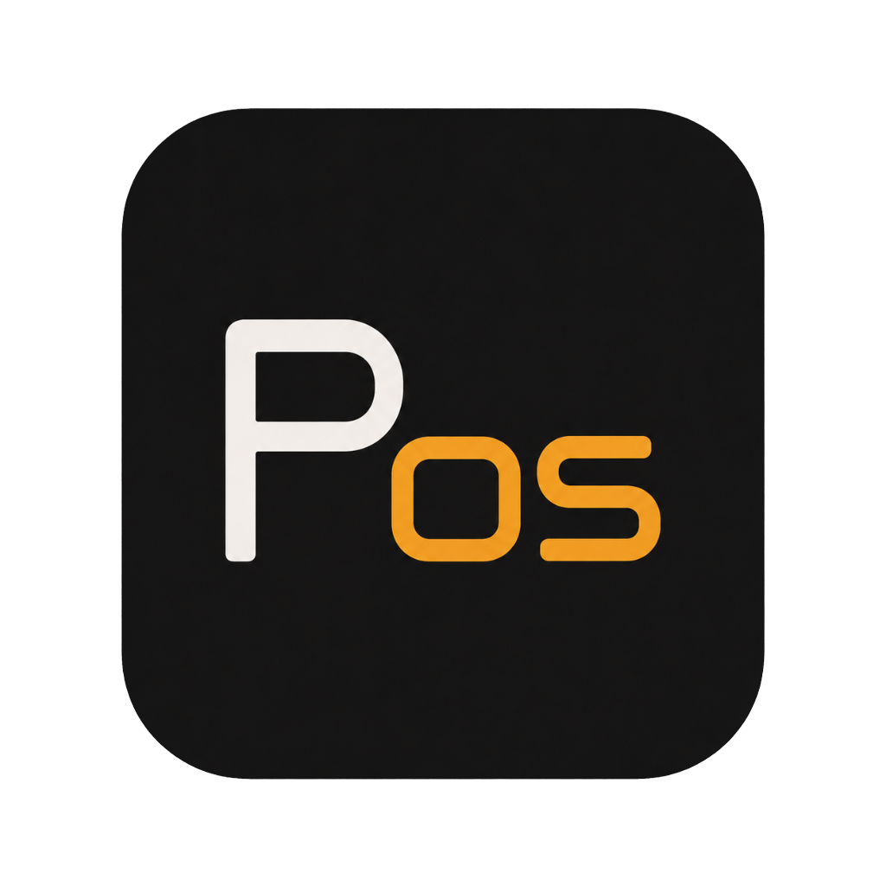

# PM Tool (PmT)

<div align="center">
  
  <h3>Enterprise Product Management Copilot &amp; Sprint Execution Workstation</h3>
  <p><b>Version 2.2.5 ("Outpost & Nexus")</b> — Local-First, Privacy-Preserving Desktop Application for Windows</p>
</div>

---

## ⚡ Overview

**PM Tool** is an enterprise-grade product management copilot engineered as a high-performance, local-first desktop application. It bridges traditional structured sprint execution (Kanban boards, backlog decomposition, decisions, and KPIs) with an autonomous AI reasoning engine capable of ingesting local company documentation, authoring living Product Requirement Documents (PRDs) and architecture RFCs, synthesizing guarded SQL analytics, and connecting bi-directionally to enterprise cloud ecosystems (**Atlassian Jira**, **Notion**, **Google Docs**) through secure, decoupled **Hexagonal Outposts**.

---

## 🌟 Key Features

### 🔌 Connection Outposts & Hexagonal Architecture Nexus (`v2.2.5`)
- **Hexagonal Architecture & 100% Local Parity (`ports/` & `adapters/`)**:
  - Presentation and AI components are completely decoupled from external network APIs, interacting exclusively via domain ports: `TicketTrackerPort`, `DocumentRepositoryPort`, and `KnowledgeSourcePort`.
  - Replicated local adapters (`LocalTicketAdapter`, `LocalArtifactsAdapter`, `LocalDiskRAGAdapter`) implement identical contracts, issue types, and label taxonomies, ensuring zero behavioral divergence when running 100% offline or air-gapped.
- **Atlassian Jira Cloud Outpost (REST API v3)**:
  - Bi-directional sprint backlog synchronization with Jira Cloud via machine-encrypted credentials.
  - Dynamic Kanban board column scaffolding dynamically generated from remote Jira status categories (`To Do`, `In Progress`, `Code Review`, `Done`).
  - 1-Click "Push to Jira" from Kanban cards, task modals, and AI Action Cards with live issue key badges (`[PROJ-102 ↗]`) and external browser deep links.
- **1:1 Label & Issue Type Synchronization**:
  - Real-time mirroring of Jira's native `labels: string[]` array across cards, filter strips, and modals.
  - Native recognition of Jira issue types (🟢 Story, 🔴 Bug, 🔷 Task, 🟣 Epic), story points, and assignees.
- **Notion Workspace & Google Docs Cloud Publishing**:
  - Automated Markdown-to-Block transformer publishing living PRDs, RFCs, and meeting notes directly into Notion database pages.
  - 1-click cloud publishing from Artifacts Studio to Google Docs using batch document update transformations.
- **Pre-Sync Safety Snapshot & Outpost-as-Dictator Model**:
  - When linking external boards, the cloud outpost acts as the authoritative dictator of state.
  - To prevent accidental data loss, PM Tool automatically dumps an atomic, timestamped JSON backup snapshot to `%LOCALAPPDATA%\PMTool\backups\pre_sync_<provider>_<id>.json` before clearing local tasks, with 1-click atomic restore capability.
- **SSRF Defensive Perimeter & PBKDF2 Credential Vault**:
  - Outpost URL validator strictly blocking loopback (`127.0.0.1`), private networks (RFC 1918), and cloud metadata endpoints (`169.254.169.254`).
  - Machine-bound, hardware-salted PBKDF2-HMAC-SHA256 encryption for API tokens in the `outpost_configs` table, with sensitive token masking (`••••••••abcd`).

### 🎛️ Configurable Token Headroom & Extended Output Budgets (`v2.2.5`)
- **Token Headroom & Generation Limits Studio (`SettingsView.tsx`)**:
  - Interactive configuration panel directly integrated into the React Desktop Settings workstation with dedicated range sliders and numeric inputs:
    - 💬 **Standard AI Chat** (`chat_max_tokens`, default 8,192, up to 32,768 tokens)
    - 📄 **File & Document Generation** (`file_gen_max_tokens`, default 16,384, up to 65,536 tokens)
    - 📋 **Plan Mode & Epics** (`plan_max_tokens`, default 8,192, up to 32,768 tokens)
    - 🛠️ **Tool Calls & Summaries** (`tool_call_max_tokens`, default 16,384, up to 65,536 tokens)
  - 1-Click Headroom Presets: `⚡ Eco (4k/8k)`, `⚖️ Balanced (8k/16k)`, and `🚀 Max (16k/32k)`.
- **Intelligent Gateway Intent Routing & Native Gemini Safety Clamping**:
  - Automatically routes generation limits based on prompt intent (`/prd`, `/breakdown`, `/document`, `/plan`, `/search`, `/summarize`).
  - Native Gemini API output clamping ($\le 8,192$ tokens) prevents upstream HTTP 400 parameter errors, while unlocking extended budgets (up to 32K/64K) for OpenAI, Ollama, and LM Studio.
- **Document Generator & Summarizer Headroom**:
  - Document Generator modal displays an active `Extended 16K Headroom` telemetry badge.
  - RAG summarizer budget expanded to 16,384 tokens default with dynamic parameter pass-through.

### 📝 Living Document Editor & Artifacts Studio (`v2.2.0`)
- **Artifacts Studio in Docs View (`ArtifactsStudio.tsx`)**:
  - Full-featured living document workstation supporting PRDs, Architecture RFCs, Sprint Briefs, Strategy Documents, and Meeting Notes.
  - Multi-mode reading and authoring: `Edit`, `Split` (synchronized side-by-side live preview), and `Preview`.
  - Comprehensive Markdown formatting toolbar (Headings, Bold, Italic, Strikethrough, Code block, Quotes, Tables, Checklist tasks).
  - Built-in document template selector (Standard PRD, Architecture RFC, Sprint Brief, Blank).
  - Debounced auto-save engine with live status indicator ("All changes saved" / "Saving...") and live word counter.
- **Multi-Format Export Engine**:
  - 1-click client-side export to Microsoft Word (`.docx`), Markdown (`.md`), and styled HTML.
- **Bridges to Sprint Kanban & Knowledge Base**:
  - 1-click bridge from living PRDs/RFCs into the Agile Decomposer modal (`DecomposerModal.tsx`) to generate INVEST user stories directly from living document text.
  - 1-click bridge to vectorize and ingest living documents into the RAG Knowledge Base.
- **AI Chat-to-Artifact Promotion Bridge**:
  - 1-click promotion button on Copilot markdown outputs converting transient chat answers into permanent, version-controlled living documents in `artifacts.db`.

### 🚀 Friction-Free First-Launch Onboarding Wizard (`v2.2.0`)
- **Interactive Multi-Step Setup Wizard (`OnboardingModal.tsx`)**:
  - Clean-launch detection via `pm_tool_onboarding_completed` localStorage signal.
  - **Step 1: Workspace & Initiative**: Project naming, domain selection, technology stack tagger, and optional seed backlog generator.
  - **Step 2: AI Gateway Probe**: Live Ollama local instance connectivity probe and model detection, alongside cloud Gemini and OpenAI gateway configuration.
  - **Step 3: Workstation Tour & Hotkey Spotlight**: Visual overview of core workstations and global keyboard shortcuts (`Ctrl+K` Command Palette, `Ctrl+B` Sidebar, `Ctrl+1..6` Quick View switching).
  - Re-accessible at any time via the Command Palette or Settings view ("Launch Onboarding Tour").

### 📈 Advanced Analytics Workbench & Story Decomposer (`v2.1.0`)
- **Multi-Stage Conversion Funnel & Drop-Off Analyzer (`tools/analytics_engine.py`)**:
  - Sequential pipeline tracking with step-to-step drop-off percentages, top-of-funnel relative conversions, and lost volume calculations with gradient visual bars.
- **Period-over-Period Cohort Retention Matrix**:
  - Automated month-over-month (MoM), week-over-week (WoW), and day-over-day (DoD) cohort construction with an interactive heatmap grid.
- **Statistical Distributions & Outlier Detection**:
  - Profiling: Mean, Median (P50), P25, P75, P90, P99, Standard Deviation, and IQR with Tukey's fences ($1.5 \times \text{IQR}$) and Z-score outlier detection.
- **Pairwise Feature Correlation Matrix & Linear Forecasting**:
  - Pearson correlation coefficients $r \in [-1.0, 1.0]$ with direction/strength classifications.
  - Time-series linear regression engine calculating slope, intercept, and $R^2$ fit with customizable forecasting horizons.
- **High-Precision INVEST Agile Story Decomposer (`DecomposerModal.tsx`)**:
  - Decomposes initiatives into INVEST user stories with 3 distinct Given/When/Then Gherkin scenarios (Happy Path, Negative Flow, Boundary/Resilience) and calibrated Fibonacci point sizing ($1, 2, 3, 5, 8, 13$).
  - Pre-commit approval step allowing engineers to inspect, adjust points, and batch-commit approved stories to the Kanban board.

### 📊 Interactive Data Studio & KPI Dashboard Studio (`v2.0.1`)
- **Full KPI Metric & Chart Lifecycle**: Create live computed KPI cards (`kpi_card`), bar distribution charts (`bar_chart`), and donut breakdowns (`donut_chart`) linked to any materialized dataset via `AddWidgetModal`.
- **Custom Benchmarks & Aggregate Variance**: Real-time evaluation of aggregations (`COUNT`, `SUM`, `AVG`, `MIN`, `MAX`), formatters (Currency, Number, Percent), target milestones, and dynamic variance badges (`▲ +12.5% vs target`).
- **Native SQLite Database File Ingestion**: Ingests `.db`, `.sqlite`, and `.sqlite3` files directly into `analytics_store.db` with streaming file-copy fallbacks and non-locking table selection.
- **Themed Dark-Mode Deletion Modal**: Replaced native browser dialogs with `DeleteDatasetModal`, matching the dark carbon aesthetic.

### 🖥️ Desktop Single Page Application (SPA) & Command Palette (`v2.0.0`)
- **Single-DOM SPA Architecture**: Pure React 19 + TypeScript + Tailwind CSS inside Electron; zero-iframe latency and hardware-accelerated transitions.
- **Global Spotlight Command Palette (`Ctrl+K` / `Cmd+K`)**: Raycast-style instant navigation across projects, tasks, RAG documents, and PM workflows with keyboard-driven filtering.
- **Universal Keyboard Shortcuts Engine**: Full desktop keybindings (`Ctrl+1..6` view switcher, `Ctrl+B` sidebar toggle, `Ctrl+K` palette, `ESC` modal dismissal).
- **Automated Background Update Lifecycle**: Silent update checks on startup and periodic 60-minute polling via `electron-updater`, non-obtrusive live status indicator pill, and automated toast alerts.

### 📁 Knowledge Base & Local RAG Pipeline
- **Deep Document Ingestion**: Ingests and parses `.pdf`, `.docx`, `.md`, `.txt`, `.csv`, and `.json` files.
- **Section-Aware Chunking & FTS5 BM25 Indexing**: Preserves heading hierarchy and performs lightning-fast Porter-stemmed BM25 keyword search.
- **Dual-Axis Sticky Table Navigation**: Custom-styled dark scrollbars with sticky table headers preventing layout distortion on wide metadata columns.

### 🔄 In-App Auto-Updating & Cascading Port Resilience
- **Differential Delta Updates**: Powered by `electron-updater` querying GitHub Releases (`Pranshul-Chopra/pm_tool`) using `.blockmap` differential files.
- **Graceful Process Teardown**: Automatically kills child Python processes before applying NSIS updates to prevent locked-file `EBUSY` errors.
- **16-Port Handshake**: Dynamically probes and binds ports `5050` through `5065` via socket checks, eliminating conflicts with zombie processes or competing developer tools.

---

## 🗄️ Architectural Segregation: The Three Databases

To maintain maximum throughput and eliminate database bloat, PM Tool isolates operations into **three independent SQLite engines**:

```text
┌────────────────────────────────────────────────────────────────────────┐
│                        THREE-DATABASE PARTITIONING                     │
├────────────────────────────────┬───────────────────────────────────────┤
│ 1. Operational Store           │ Path: %LOCALAPPDATA%\PMTool\pmtool.db │
│    • Sprints, tasks & cards    │ • Write-Ahead Logging (WAL) mode      │
│    • Projects & initiatives    │ • Outpost configurations & vault      │
│    • Outpost transaction queue │ • Connection pooling & foreign keys   │
├────────────────────────────────┼───────────────────────────────────────┤
│ 2. Artifacts Store             │ Path: %LOCALAPPDATA%\PMTool\artifacts.db
│    • Living PRDs & RFCs bodies │ • SQLite FTS5 full-text search index  │
│    • Markdown AST revisions    │ • Historical version snapshot tree    │
│    • Multi-format export cache │ • Zero bloat on operational queries   │
├────────────────────────────────┼───────────────────────────────────────┤
│ 3. AI Context Store            │ Path: %LOCALAPPDATA%\AIContextTool\   │
│    • Conversation threads      │   ai_context.db                       │
│    • RAG knowledge chunks      │ • BM25 Porter-stemmed search index    │
│    • Diagnostic audit runs     │ • Clean isolation from user records   │
└────────────────────────────────┴───────────────────────────────────────┘
```

---

## 🏗️ Tech Stack

- **Desktop Shell:** Electron 44.x (Chromium sandbox, custom window controls, safe IPC preload bridge)
- **Frontend SPA:** React 19, TypeScript 5.x, Tailwind CSS, Lucide Icons, Vite 8.x
- **Backend Server:** Flask 3.x (local loopback binding, origin verification, security middleware)
- **Databases:** SQLite 3 (WAL mode, FTS5 full-text search, thread-safe connection pooling)
- **AI / LLM Layer:** Local Ollama (`llama3.2`, `llama3.1`, `mistral`), Google Gemini REST API, OpenAI-compatible custom endpoints
- **Packaging:** PyInstaller (headless Flask backend) + electron-builder (NSIS 1-Click Installer & Portable Windows binaries)

---

## 📂 Project Structure

```text
pm_tool/
├── .github/
│   └── workflows/
│       └── release.yml          # Automated GitHub Actions CI/CD pipeline
├── README.md                    # Project overview & documentation landing page
├── RELEASE_WORKFLOW.md          # Packaging, publishing, and auto-update guide
├── CHANGELOG.md                 # Semantic versioning history (v2.2.5 current)
├── DEV_HANDBOOK.md              # Technical engineering handbook & architecture spec
├── IMPLEMENTATION_PLAN_v225_OUTPOSTS.md # Hexagonal Outposts specification
├── requirements.txt             # Python dependencies
├── version.json                 # Single source of truth for version (2.2.5)
├── main.py                      # Flask factory, server lifecycle, port discovery
├── routes.py                    # REST API controllers (Projects, Tasks, Outposts, AI)
├── db.py                        # SQLite schema migrations v8 & connection pool (pmtool.db)
├── artifacts_db.py              # Dedicated SQLite living docs engine (artifacts.db)
├── ai_db.py                     # SQLite context store, conversation history (ai_context.db)
├── data_engine.py               # Analytical ingestion, guarded SQL engine, KPI widgets
├── notifier.py                  # Cross-platform desktop notification service
├── test_v225_outposts.py        # Automated test suite for Outposts & Hexagonal Ports
├── test_v220_artifacts.py       # Automated test suite for Artifacts & Database separation
│
├── ports/                       # Hexagonal Architecture Abstract Domain Contracts
│   ├── __init__.py
│   ├── ticket_tracker.py        # TicketTrackerPort, BoardSchema, TaskEntity
│   ├── document_repo.py         # DocumentRepositoryPort, DocumentEntity
│   └── knowledge_source.py      # KnowledgeSourcePort, RawDocumentPayload
│
├── adapters/                    # Concrete Domain Adapters (Local & Cloud Outposts)
│   ├── __init__.py
│   ├── local_ticket_adapter.py  # Local SQLite ticket tracker (100% contract parity)
│   ├── jira_ticket_adapter.py   # Atlassian Jira Cloud REST API v3 adapter
│   ├── local_artifacts_adapter.py # Local living documents adapter (artifacts.db)
│   ├── notion_document_adapter.py # Notion Workspace Markdown-to-Block adapter
│   ├── gdocs_document_adapter.py  # Google Docs & Drive batch export adapter
│   └── local_disk_rag_adapter.py  # Local disk RAG adapter with BM25 indexing
│
├── tools/                       # Productivity tools & Outposts subsystem
│   ├── __init__.py
│   ├── analytics_engine.py      # Funnels, cohort retention, correlation, outliers
│   ├── story_decomposer.py      # Automated PRD-to-Agile INVEST story decomposer
│   ├── document_generator.py    # Formatted DOCX/Markdown specification generator
│   ├── summarizer.py            # Document summarizer with 16K token budget & SHA256 integrity
│   └── outposts/                # Outpost Security & Snapshot Subsystem
│       ├── __init__.py
│       ├── security.py          # SSRF URL validator & PBKDF2 machine-bound vault
│       └── snapshot.py          # Pre-sync safety backup snapshot & atomic restore
│
├── llm/                         # LLM Gateway and multi-provider abstraction
│   ├── __init__.py
│   └── gateway.py               # Key encryption, Ollama probe, token headroom clamping
│
├── rag/                         # Local-first document ingestion and retrieval pipeline
│   ├── __init__.py
│   ├── parsers.py               # Parsers for PDF, DOCX, MD, TXT, CSV, JSON
│   ├── chunker.py               # Section-aware sliding-window chunker
│   └── engine.py                # Directory scanner and BM25 retrieval
│
├── electron/                    # Desktop shell & React 19 SPA client
│   ├── package.json             # Electron configuration & auto-updater targets (v2.2.5)
│   ├── main.js                  # Cascading port discovery, process supervisor, auto-updater
│   ├── preload.js               # Isolated IPC bridge (electronUpdater, electronNotifier)
│   ├── src/                     # React 19 + TypeScript + Tailwind single-DOM client
│   │   ├── App.tsx              # Root shell layout, keyboard shortcuts engine
│   │   ├── components/          # Titlebar, Sidebar, CommandPalette, Modals
│   │   │   ├── board/           # LinkJiraModal.tsx (pre-sync warning & snapshot dialog)
│   │   │   ├── chat/            # MarkdownContent.tsx, DocumentGeneratorModal.tsx
│   │   │   ├── docs/            # ArtifactsStudio.tsx (living docs editor & cloud export)
│   │   │   ├── kanban/          # TaskCard.tsx, DecomposerModal.tsx
│   │   │   ├── onboarding/      # OnboardingModal.tsx (first-launch setup tour)
│   │   │   ├── settings/        # OutpostsSettingsPanel.tsx (Jira, Notion, GDocs hub)
│   │   │   └── studio/          # AddWidgetModal.tsx, DeleteDatasetModal.tsx
│   │   ├── views/               # BoardView, DocumentsView, StudioView, ChatView, SettingsView
│   │   └── services/bridge.ts   # Unified API bridge for local Flask REST endpoints
│   ├── icon.ico                 # Multi-resolution Windows app icon (PmT)
│   └── icon.png                 # Taskbar & notification icon
│
└── static/                      # Static assets & compiled SPA bundle
    ├── spa/                     # Production compiled Vite SPA client (index.html, assets)
    └── fonts/                   # Offline IBM Plex Sans & Mono woff2 fonts
```

---

## 🗺️ Project Roadmap & Status

| Release Milestone | Key Capabilities | Status & Priority |
| :--- | :--- | :--- |
| **v2.0.1** | **Interactive KPI Dashboard & Ingestion Hardening**<br>• Full KPI metric cards & chart breakdown lifecycle (`kpi_card`, `bar_chart`, `donut_chart`)<br>• Native SQLite database ingestion (`.db`, `.sqlite`, `.sqlite3`) & streaming copy fallback<br>• Dark-mode `DeleteDatasetModal` (zero browser alerts)<br>• Polymorphic SQL grid row rendering (`array` & `object`)<br>• Story Decomposer gateway resilience | ✅ **Shipped** |
| **v2.0.0** | **Desktop SPA Modernization & Command Palette**<br>• Full React 19 + TypeScript single-DOM client<br>• Spotlight Command Palette (`Ctrl+K` / `Cmd+K`)<br>• Universal Keyboard Shortcuts Engine<br>• Automated silent background update lifecycle<br>• Zero-iframe architecture & decommissioned Jinja bundle | ✅ **Shipped** |
| **v1.5.0** | **AI Document Generator & Multi-Format Export**<br>• 1-click PM document modal (PRDs, specs, breakdowns, strategy)<br>• In-memory Word (.docx) & Markdown (.md) exports<br>• 1-click Knowledge Base ingestion & FTS5 indexing<br>• Direct PRD sprint board decomposition<br>• Hardened zero-crash Markdown parser & ErrorBoundary | ✅ **Shipped** |
| **v1.4.0** | **Data Studio & Safe SQL Analytics**<br>• Guarded SQLite sandbox with AST/whitelist checks<br>• Dynamic KPI cards, benchmarks, and SVG charts<br>• Excel (.xlsx), CSV, TSV dataset materialization | ✅ **Shipped** |
| **v1.3.0** | **Agile Sprint Board & PRD Decomposer**<br>• Story points, acceptance criteria, assignee tracking<br>• Automated PRD-to-Story AI generator (`/breakdown`) | ✅ **Shipped** |
| **v1.2.0** | **In-App Auto-Updater & Assets**<br>• Differential delta background auto-updater<br>• Dynamic cascading port fallback (`5050`–`5065`) | ✅ **Shipped** |
| **v2.1.0** | **Advanced Analytics, Story Decomposer & What's New**<br>• Calibrated INVEST User Story Decomposer with pre-commit modal & calibrated story points<br>• Advanced Analytics Engine (cohort retention, conversion funnels, correlation matrix, statistical outliers, forecasting)<br>• Data Studio Analytics Workbench integration<br>• Post-update "What's New" release notes modal with restart gating | ✅ **Shipped** |
| **v2.2.0** | **Onboarding Wizard & Contextual Artifacts Studio**<br>• 🚀 **User Onboarding Flow for First-Time App Launches** (clean-launch detection, initial workspace setup, local Ollama vs cloud AI gateway config, workstation feature tour)<br>• 📝 **Contextual Artifacts Management (Docs - PranshulOS Style)** (in-built rich living document editor, chat-to-document promotion, 1-click export to Markdown, Word `.docx`, & HTML)<br>• 🗄️ **Segregated Database Architecture (`artifacts.db`)** (dedicated 3rd database for document bodies and markdown ASTs to prevent bloat in `pmtool.db` and `ai_context.db`) | ✅ **Shipped** |
| **v2.2.5 (Latest)** | **Connection Outposts & Hexagonal Architecture Nexus (Jira, Notion, Google Docs)**<br>• 🌐 **Hexagonal Architecture & 100% Local Parity** (`ports/` contracts and `adapters/` for Jira, Notion, GDocs, and local SQLite)<br>• 🔗 **Jira Outpost & Backlog Sync** (two-way ticket synchronization, Jira REST API v3 adapter, dynamic workflow column scaffolding, 1-click "Push to Jira", 1:1 label synchronization)<br>• 📄 **Notion & Google Docs Outpost** (cloud publishing of living PRDs/RFCs from Artifacts Studio to Notion Databases/Pages & Google Docs; RAG knowledge base ingestion)<br>• 🛡️ **Pre-Sync Safety Snapshot & Outpost-as-Dictator Model** (automatic JSON backup snapshots before sync, atomic restore, zero data loss)<br>• 🔒 **SSRF Defensive Perimeter & Machine-Bound Credential Vault** (hardware-salted PBKDF2 encryption, loopback/private IP blocking, token masking)<br>• 🎛️ **Configurable Token Headroom** (React Settings sliders and presets for Chat, Docs, Plans, Tools with native Gemini safety clamping) | ✅ **Shipped** |
| **v2.3.0** | **Team Workspaces & Multi-Vault Architecture**<br>• Isolated project vaults with segregated SQLite databases & collections<br>• Encrypted workspace export, portability & cross-machine synchronization | 🔥 **Next Up (Upcoming Milestone)** |

---

## 🛠️ Getting Started (Development)

### 1. Prerequisites
- **Python 3.11 or 3.13**
- **Node.js (v18+) & npm**

### 2. Python Environment Setup
```powershell
# Create and activate virtual environment
python -m venv venv
.\venv\Scripts\activate

# Install dependencies
pip install -r requirements.txt
```

### 3. Start Flask Backend
```powershell
python main.py
```
> The server will automatically discover and bind to an available port in the range `5050`–`5065`.

### 4. Start Electron Desktop Shell
In a separate terminal:
```powershell
cd electron
npm install
npm start
```

---

## 📦 Building Standalone Release Binaries

To produce the Windows 1-Click NSIS installer and Portable executable locally:

```powershell
# Set build flag
$env:CSC_IDENTITY_AUTO_DISCOVERY="false"

# Run automated 4-stage build script
.\build.bat
```

Output assets will be generated in `release/`:
- `release/PM-Tool-Setup-2.2.5.exe` (1-Click NSIS Installer)
- `release/PM-Tool-2.2.5.exe` (Portable Executable)
- `release/PM-Tool-Setup-2.2.5.exe.blockmap` (Differential update map)
- `release/latest.yml` (Auto-update manifest)

---

## 📄 License & Ownership

PM Tool is developed and maintained by **Pranshul Chopra**. All rights reserved.
